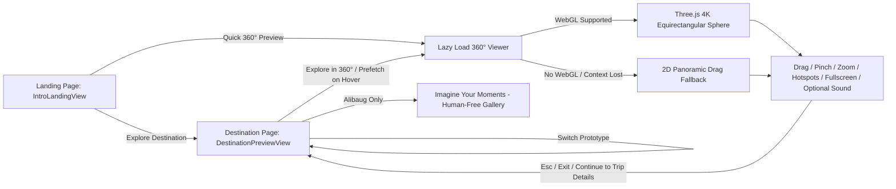

# MyTravWay — Experience Before You Arrive

An interactive, dual-destination web prototype for **MyTravWay** demonstrating how adventure travelers can optionally explore destinations inside a photorealistic 360° panoramic environment before reading trip details or planning a journey.

> **Core Concept:** *"Experience the destination before you arrive."*

---

## Featured Prototype Destinations

| Destination | Setting | Panorama Asset | Anchored Hotspots | Optional Soundscape |
| :--- | :--- | :--- | :--- | :--- |
| **Kalsubai Summit** (Phase 1) | Sahyadri Range, Maharashtra (`1,646 m` verified peak) | `4096 × 2048` (`2:1`) sunrise summit equirectangular (`sahyadri-dawn` HUD theme) | **3**: `01 Summit Viewpoint`, `02 Surrounding Valley`, `03 Sunrise View` | Single toggle: **Mountain Wind** (muted by default) |
| **Alibaug Night Camping** (Phase 2 — Midnight Beach Escape) | Konkan Coast, Raigad, Maharashtra | `4096 × 2048` (`2:1`) 100% human-free moonlit beach campsite equirectangular (`midnight-coastal` HUD theme) | **4**: `01 The Campsite`, `02 The Bonfire`, `03 The Moonlit Shore`, `04 Under the Stars` | Multi-channel mixer: **Ocean Waves**, **Gentle Night Wind**, **Bonfire Crackling** + **Play All / Mute All** (muted by default) |

---

## Key Features

- **Editorial Landing Showcase**: Introduces the concept and lets visitors compare **Kalsubai Summit** and **Alibaug Night Camping**, with direct navigation to full destination pages or quick 360° previews.
- **Accessible Destination Detail Pages**: Displays structured facts (**Verified** geographic data vs. **Sample** trip pacing), theme-matched *"Before You Go"* 360° entry cards, narrative overviews, sample progression stages, preparation notes, and cross-destination switching.
- **Optional Environmental Storytelling — *Imagine Your Moments* (Alibaug)**: Dedicated, collapsible gallery separate from the 360° environment depicting four strictly human-free coastal moments (*The Coastal Escape*, *The Little Things*, *The Midnight Sky*, and *The First Light*)—explicitly disclosed as aspirational mood themes rather than guaranteed package activities.
- **Reusable Theme-Driven 360° WebGL Sphere Viewer**:
  - Built directly with native `THREE.WebGLRenderer`, `THREE.SphereGeometry` (inverted sphere with `DoubleSide`), and `OrbitControls` inside an isolated canvas container—keeping the initial page lightweight and preventing React 19 reconciler unmount conflicts.
  - Supports theme-specific HUD palettes (`sahyadri-dawn` charcoal/forest for Kalsubai; `midnight-coastal` midnight navy, deep ocean blue, muted teal, warm amber, and soft champagne for Alibaug) driven purely by destination configuration.
  - Smooth branded loading reveal, dismissible interaction hint (`"Drag to explore your surroundings"`), drag-vs-click protection, wheel & two-finger pinch-to-zoom, **Zoom In / Out**, **Reset View**, **Fullscreen**, **Help** popover, keyboard **`Esc`** dismissal, and **scroll + focus restoration** upon exiting.
  - Real-time 3D-to-2D projected hotspot beacons with subtle CSS pulse rings, hover/focus name tooltips, and compact editorial cards (bottom-sheet overlay on mobile viewports) with zero per-frame React re-renders.
  - Automatic GPU capability detection (`MAX_TEXTURE_SIZE` downscaling guard, software-WebGL frame pacing, `webglcontextlost` handling) plus a **2D panoramic drag fallback** if WebGL is unavailable.
- **Zero-404 Procedural Web Audio Engine**: Synthesizes mountain wind, rolling ocean swells, gentle coastal breeze, and crackling driftwood fire purely in-browser via the Web Audio API (`AudioContext`, pink/brown noise buffers, LFO-modulated bandpass/lowpass filters). Strictly opt-in (no autoplay) and immediately disposed on exit.

---

## Complete Tech Stack

| Layer | Technology | Version / Purpose |
| :--- | :--- | :--- |
| **UI Framework** | React + React DOM | `^19.0.1` — Component architecture, `lazy` + `Suspense` code splitting |
| **Language** | TypeScript | `^7.0.2` — Strict static typing (`noEmit` check via `tsc`) |
| **Build & Dev Server** | Vite + `@vitejs/plugin-react` | `^8.3.0` / `^6.1.1` — Fast HMR dev server (`:3000`) & custom `src/assets` bundle copy plugin |
| **Styling & Design System** | Tailwind CSS v4 (`@tailwindcss/vite`) | `^4.3.3` — Custom tokens (`#183C32`, `#151B19`, `#0B1424`, `#13293D`, `#1E4D54`, `#F5F0E7`, `#C9B99D`, `#E5D3B3`, `#D68A45`) |
| **Typography** | Google Fonts | `Fraunces` (editorial display), `Plus Jakarta Sans` (body), `JetBrains Mono` (tabular indices) |
| **3D & Panorama Engine** | Three.js (`three` + `@types/three`) | `^0.187.0` — Inverted spherical projection, `SRGBColorSpace` texture upload, `OrbitControls`, `anisotropy` filtering |
| **Icons** | `lucide-react` | `^0.546.0` — Minimal affordance icons across HUD, audio controls, and cards |
| **Audio Synthesis** | Native Web Audio API | Zero external `.mp3`/`.wav` dependencies; real-time procedural soundscapes |

---

## Architecture Diagram

### 1. Application & Rendering Architecture

```text
+-----------------------------------------------------------------------------------+
|                                    src/App.tsx                                    |
|  State: activeView ('intro' | 'destination'), selectedDestinationId, isViewerOpen |
|  Refs: savedScrollYRef & lastTriggerElRef (restores scroll & focus on modal exit) |
+-----------------------------------------+-----------------------------------------+
                                          |
          +-------------------------------+-------------------------------+
          |                               |                               |
          v                               v                               v
+-------------------+         +------------------------+      +-----------------------+
|   TopNavBar.tsx   |         |  IntroLandingView.tsx  |      | DestinationPreviewView|
| 3-zone header bar |         | Hero + 2 Destination   |      | Facts bar, themed     |
| Overview / Dest / |         | cards (Kalsubai &      |      | Before You Go CTA,    |
| Before You Go     |         | Alibaug) + Rationale   |      | Stages, Notes &       |
+-------------------+         +------------------------+      | Imagine Your Moments  |
                                                              +-----------+-----------+
                                                                          |
                                       Lazy-loaded on demand (React.lazy) |
                                                                          v
+-----------------------------------------------------------------------------------+
|                   src/immersive/ImmersivePanoramaModal.tsx                        |
|                                                                                   |
|  +---------------------------------------+   +---------------------------------+  |
|  | WebGL Capability Probe & Asset Loader |   |  AmbientSoundEngine             |  |
|  | (equirectangularTexture.ts)           |   |  (src/immersive/ambientAudio.ts)|  |
|  | - Checks WebGL2/WebGL + MAX_TEXTURE   |   |  - mountain-wind                |  |
|  | - Loads 4096x2048 2:1 panorama        |   |  - ocean-waves                  |  |
|  +-------------------+-------------------+   |  - night-wind                   |  |
|                      |                       |  - bonfire-crackle              |  |
|         +------------+------------+          |  (Muted by default, no autoplay)|  |
|         | WebGL OK                | Fallback +---------------------------------+  |
|         v                         v                                               |
|  +-----------------------------+  +--------------------------------------------+  |
|  | WebGLPanoramaViewport       |  | Fallback2DPanorama                         |  |
|  | - Isolated <div ref> mount  |  | - Pointer drag U-panning + pinch/CSS zoom  |  |
|  | - SphereGeometry(500,96,64) |  | - Projected 2D hotspot beacons             |  |
|  | - OrbitControls + damp FOV  |  +--------------------------------------------+  |
|  | - Pinch-to-zoom + drag guard|                                                  |
|  | - Vector3.project() -> DOM  |  Theme-Driven HUD Overlays (VIEWER_THEMES):      |
|  |   hotspot beacons (zero R3F)|  - Top info bar (Help, Sound/Mixer, Exit)      |
|  +-----------------------------+  - Dismissible drag hint + Editorial card        |
|                                   - Zoom/Reset/Fullscreen/Continue bottom dock    |
+-----------------------------------------------------------------------------------+
                                          ^
                                          | Driven by reusable config
                        +-----------------+-----------------+
                        |     src/data/destinations.ts      |
                        |  DESTINATIONS['kalsubai-summit']  |
                        |  DESTINATIONS['alibaug-night-...']|
                        +-----------------------------------+
```

### 2. User Journey Flow (Mermaid)



---

## Project Structure

```text
├── index.html                                  # Entry HTML, SEO/OG metadata & Google Fonts
├── metadata.json                               # App manifest metadata
├── package.json                                # Dependencies & npm scripts
├── tsconfig.json                               # TypeScript compiler configuration
├── vite.config.ts                              # Vite config + dist/src/assets copy plugin
├── README.md                                   # Project documentation
└── src/
    ├── main.tsx                                # React 19 root mount
    ├── index.css                               # Tailwind v4 theme variables, pulse ring & reduced-motion rules
    ├── App.tsx                                 # Navigation state, lazy viewer, scroll & focus restoration
    ├── assets/
    │   └── images/
    │       ├── hero_sahyadri_sunrise_1795532417756.jpg
    │       ├── kalsubai_summit_plateau_1795532418792.jpg
    │       ├── kalsubai_trail_ridge_1795532419006.jpg
    │       ├── kalsubai_equirect_4k_final.jpg            # 4096x2048 2:1 summit panorama
    │       ├── alibaug_midnight_hero_1795537060161.jpg   # Human-free midnight campsite hero/card
    │       ├── alibaug_beach_atmosphere_1795534345795.jpg
    │       ├── alibaug_midnight_equirect_4k.jpg          # 4096x2048 2:1 human-free night panorama
    │       ├── story_coastal_escape_1795537059823.jpg    # Imagine Your Moments: The Coastal Escape
    │       ├── story_little_things_1795537060929.jpg     # Imagine Your Moments: The Little Things
    │       ├── story_midnight_sky_1795537061399.jpg      # Imagine Your Moments: The Midnight Sky
    │       └── story_peaceful_morning_1795534347240.jpg  # Imagine Your Moments: The First Light
    ├── components/
    │   ├── TopNavBar.tsx                       # Sticky 3-zone header navigation
    │   ├── IntroLandingView.tsx                # Landing hero & dual-destination cards
    │   ├── DestinationPreviewView.tsx          # Facts, Before You Go, stages, notes & Imagine Your Moments
    │   └── ResilientImage.tsx                  # Image wrapper with graceful fallback UI
    ├── data/
    │   └── destinations.ts                     # Reusable multi-destination, theme, hotspot & audio config
    └── immersive/
        ├── ImmersivePanoramaModal.tsx          # Fullscreen Three.js 360° viewer, HUD & 2D fallback
        ├── equirectangularTexture.ts           # Spherical math & MAX_TEXTURE_SIZE-safe image loader
        └── ambientAudio.ts                     # Multi-channel procedural Web Audio synthesizer
```

---

## How to Run on Your Device

### 1. Prerequisites

- **Node.js**: Version `20.x` or `22.x` LTS (check with `node -v`)
- **npm**: Version `10+` (bundled with Node.js; check with `npm -v`)
- **Browser**: Any modern WebGL-capable browser (Chrome, Edge, Firefox, Safari on desktop or mobile). No API keys or `.env` secrets are required to run the app locally.

### 2. Install & Start Locally (Desktop: macOS, Linux, Windows)

```bash
# 1. Navigate into the project directory
cd <project-folder>

# 2. Install all dependencies
npm install

# 3. Start the Vite development server on port 3000
npm run dev
```

Once started, open your browser and visit:

- **Local URL**: `http://localhost:3000`

### 3. Open & Test on a Mobile Phone or Tablet (Same Wi-Fi)

The `dev` script runs Vite with `--host=0.0.0.0 --port=3000`, which exposes the dev server across your local Wi-Fi network so you can test touch drag-to-look, pinch/button zoom, and mobile audio directly on a phone or tablet:

1. Keep `npm run dev` running on your computer.
2. Find your computer's local IPv4 address:
   - **macOS**: `ipconfig getifaddr en0` (or System Settings → Wi-Fi → Details)
   - **Windows**: `ipconfig` in Command Prompt → look for **IPv4 Address** (e.g., `192.168.1.42`)
   - **Linux**: `hostname -I | awk '{print $1}'`
3. Ensure your phone/tablet is connected to the **same Wi-Fi network** (and allow port `3000` if your OS firewall prompts).
4. Open your mobile browser and visit:
   `http://<YOUR_LOCAL_IP>:3000` (for example, `http://192.168.1.42:3000`).

> **Note on Web Audio on Mobile & Desktop**: Browsers require a direct tap/click gesture before activating `AudioContext`. All sound controls start muted by default and activate immediately when you tap **Wind On** or any channel inside **Ambience**.

### 4. Available Scripts

| Command | Description |
| :--- | :--- |
| `npm run dev` | Starts the Vite development server on `http://localhost:3000` (`0.0.0.0`) |
| `npm run lint` | Runs TypeScript type checking (`tsc --noEmit`) with zero output files |
| `npm run build` | Builds the optimized production bundle into `dist/` and copies `src/assets/` into `dist/src/assets/` |
| `npm run preview` | Serves the production `dist/` bundle locally to verify the final build |
| `npm run clean` | Removes `dist/` and `server.js` build artifacts |

To test the production build locally:

```bash
npm run lint
npm run build
npm run preview -- --host=0.0.0.0 --port=3000
```

### 5. Troubleshooting Tips

- **Port 3000 already in use**: Stop any existing process on port `3000` or override with `npx vite --port=3001 --host=0.0.0.0`.
- **Blank/slow 3D view on an older device or VM**: The viewer automatically detects software WebGL or low `MAX_TEXTURE_SIZE` (`< 4096`), scales textures safely, and falls back to the interactive 2D panoramic drag viewer if WebGL is disabled.
- **Images returning 404 in a custom static server**: Always serve from the root of `dist/` generated by `npm run build` (which includes `dist/src/assets/images/` via `vite.config.ts`).

---

## Prototype Scope & Data Transparency

- **Illustrative 360° Scenery**: Both equirectangular panoramas are clearly labeled **`Illustrative 360° Sample`** until authentic field-captured Kalsubai and Alibaug footage is acquired.
- **Verified Facts vs. Sample Content**: Geographic names and elevations (`1,646 m / 5,400 ft` for Kalsubai; Konkan Coast / Mandwa approach for Alibaug) are marked **Verified**. Trail difficulty, ascent/stay windows, progression stages, packing notes, and Alibaug storytelling moments are marked **Sample / Illustrative** and do not represent guaranteed inclusions or live itineraries.
- **Out of Scope**: User authentication, payment gateways, live batch pricing/availability, user reviews, and backend booking services are intentionally excluded in this Phase 1–2 demonstration prototype.
